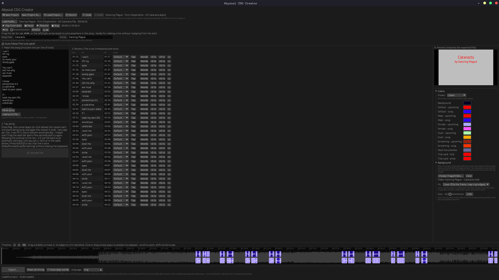
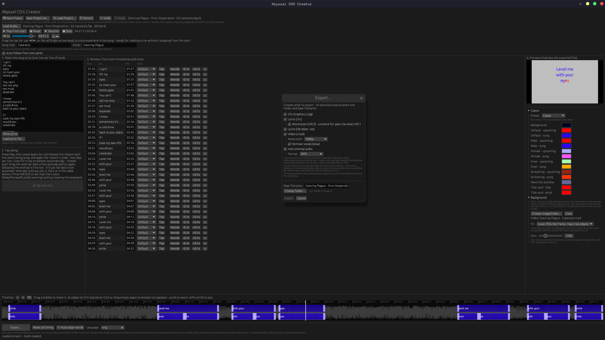
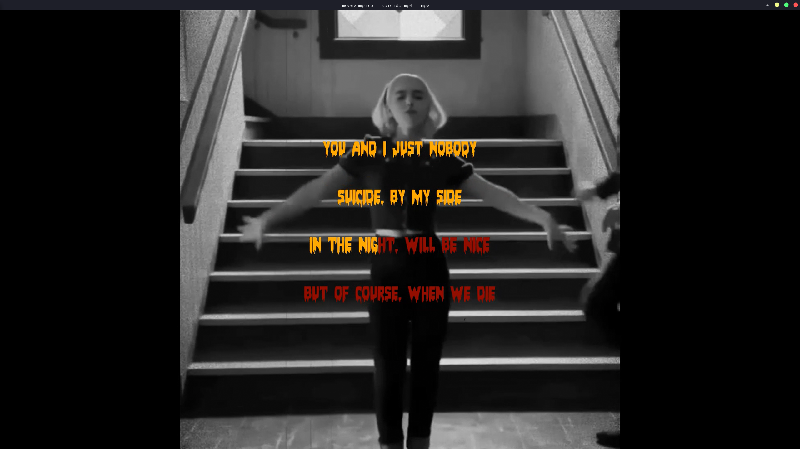

# Abyssal CDG Creator

**Make real karaoke files from a song and its lyrics.** Load the audio,
paste the lyrics, tap along - and export a `.cdg` for karaoke machines and
MP3+G players, an MP4 karaoke video, subtitles, or lyric files.

[](https://github.com/AbyssalOath/abyssal-cdg/actions/workflows/ci.yml)
[](https://github.com/AbyssalOath/abyssal-cdg/releases/latest)




Free and open source, for Windows, macOS and Linux. Everything - vocal
removal, video export, auto-alignment - runs on your own computer, with
nothing extra to install.

**You're responsible for the audio and lyrics you use with this tool** -
see [DISCLAIMER.md](DISCLAIMER.md).

## Download

Get the installer for your system from the
**[latest release](https://github.com/AbyssalOath/abyssal-cdg/releases/latest)**:
`.msi`/`.exe` (Windows), `.dmg` (macOS), `.AppImage`/`.deb` (Linux).

The app isn't code-signed, so the first launch shows a warning on Windows
and macOS, and the Linux AppImage needs `chmod +x` first.
**[docs/INSTALLING.md](docs/INSTALLING.md)** has the one-click way past
each, plus how to verify your download.

## Your first song in five steps

The **step bar** across the top of the app walks you through these and
always shows what to do next.

1. **Audio** - load the song (mp3, wav, flac, ogg, m4a, aac), or drop it
   on the window.
2. **Lyrics** - paste them (one line per line; a blank line starts a new
   verse) and click **Parse lyrics**, or load an LRC/UltraStar/KOK file.
3. **Tap** - press Play, then **Space** the instant each line starts and
   again when it ends. Slow the song down or loop a line if it's fast.
4. **Fine-tune** *(optional)* - click words as they're sung, drag bubbles
   on the timeline, or let **🪄 Auto-align** do it from the audio.
5. **Export** - pick your formats, check the pre-export checklist, done.

Press **F1** in the app for every keyboard shortcut, and untick **💡 Tips**
once you know your way around.

## Highlights

**Timing**
- Tap-along with latency compensation, slow-down (0.5×/0.75×), line and A-B
  looping, and one-tap hand-off for lines sung back to back.
- Word-by-word fine-tuning - by clicking, on a waveform timeline, or
  automatically with **auto-align** (a speech model run against isolated
  vocals; best-effort, so give it a listen).
- **Syllable timing** for held words: `beau|ti|ful`.
- **Copy a chorus's timing** onto its repeats in one go.

**Looks**
- Color presets and per-voice colors (Male/Female/Duet/Screaming/Backing,
  plus your own singer names), with readability warnings for the `.cdg`'s
  16-color palette.
- Overlapping **backing vocals** in their own lane.
- Background image or video, custom fonts, text outline/shadow, an outro
  card.
- A live preview that can switch to the **exact** `.cdg` output.

**Exports** (any combination at once, or a batch of saved projects)
- `.cdg` (+ MP3+G `.zip`) for karaoke machines and KJ software.
- MP4 video in 16:9 or vertical 9:16, 720p to 4K.
- Instrumental and vocals-only audio (built-in AI vocal removal).
- `.ass` karaoke subtitles, `.srt`, LRC and UltraStar.

The full walkthrough is in **[FEATURES.md](FEATURES.md)**, and the newest
changes are in **[CHANGELOG.md](CHANGELOG.md)**.

<details>
<summary>More screenshots</summary>





</details>

## Building from source

```bash
cargo build --release
cargo run --release
```

Needs Rust 1.88+ and, on Linux, a few system packages - see
**[docs/BUILDING.md](docs/BUILDING.md)**.

## Documentation

| Read this | For |
|---|---|
| [FEATURES.md](FEATURES.md) | Every feature, how to use it, and known limitations |
| [docs/INSTALLING.md](docs/INSTALLING.md) | Installing, first-launch warnings, verifying downloads |
| [docs/BUILDING.md](docs/BUILDING.md) | Building from source and running the tests |
| [BUILD_TROUBLESHOOTING.md](BUILD_TROUBLESHOOTING.md) | When `cargo build` fails |
| [ARCHITECTURE.md](ARCHITECTURE.md) | How the code is organized and why |
| [docs/LEARN_THE_CODE.md](docs/LEARN_THE_CODE.md) | A code-level walkthrough of every file (also in the app's Codex) |
| [CONTRIBUTING.md](CONTRIBUTING.md) | Conventions and how to propose changes |
| [SECURITY.md](SECURITY.md) | Attack surface and reporting a vulnerability |
| [CHANGELOG.md](CHANGELOG.md) | What changed in each version |
| [DISCLAIMER.md](DISCLAIMER.md) | Your responsibility for the content you use |
| [THIRD_PARTY_LICENSES.md](THIRD_PARTY_LICENSES.md) | Bundled binaries, models and dependency licenses |

## Support the project

If Abyssal CDG Creator is useful to you, please consider
[supporting its development on Ko-fi](https://ko-fi.com/abyssaloath).
